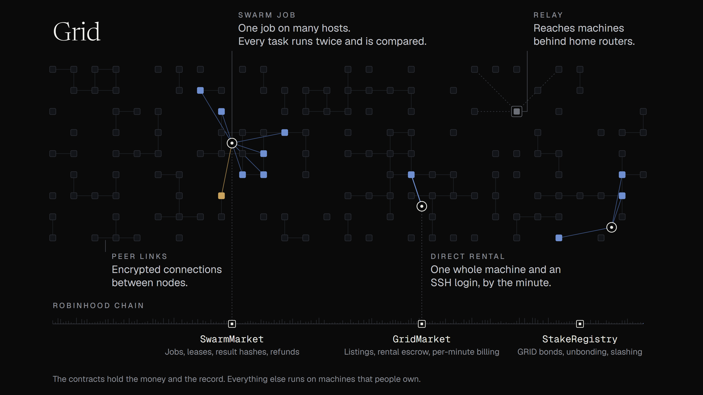

# Grid

Decentralized compute on Robinhood Chain.

Grid lets people rent computing time from the people who own the machines. It has no servers of its own: money is held by contracts on Robinhood Chain, the work happens on hosts' machines, and renters and hosts talk to each other directly or through relays run by other hosts. [How Grid is decentralized](decentralization.md) covers who runs each part and what each can and cannot do.

**Site:** [grid-5y8.pages.dev](https://grid-5y8.pages.dev) · **Source:** [github.com/Grid-Decentralized-Compute/grid](https://github.com/Grid-Decentralized-Compute/grid) · **X:** [@Grid_Compute](https://x.com/Grid_Compute)

## Two ways to rent

| | Direct | Swarm |
| --- | --- | --- |
| What you get | One whole machine with an SSH login | One job split into tasks, spread across many hosts |
| Billing | Per started minute, unused time refunded | Per accepted run, unused runs refunded |
| If a host goes offline | The session ends; you pay only for minutes started | Its tasks move to other hosts |
| Results | Whatever the machine produces | Each task checked by a second host against an on-chain hash |
| Best for | Interactive work, training, notebooks | Rendering, batch inference, transcoding, simulations |

## The parts

| Part | What it does |
| --- | --- |
| `GridMarket` | Machine listings, ETH escrow for direct rentals, settlement per started minute |
| `SwarmMarket` | Swarm jobs, task leases, result hashes, tie-breaks, refunds |
| `StakeRegistry` | The GRID bond hosts post to stay listed, unbonding and slashing |
| The node | The program a host runs: direct rentals, swarm work when idle, the peer-to-peer network |
| The network | libp2p: encrypted connections, a DHT, signed heartbeats, relays for machines behind routers |
| The site | Reads the contracts and talks to nodes. It holds nothing, and anyone can run their own |

## Status

Grid is experimental software. The contracts have not been audited. Nothing here is financial, investment, legal or tax advice. The source is MIT licensed.
