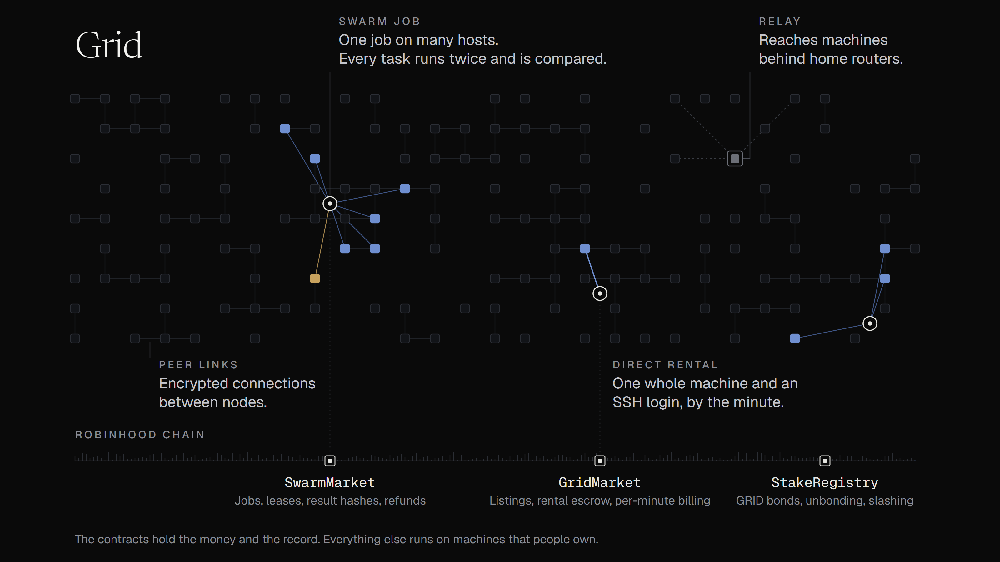

# How Grid is decentralized

Grid has no servers of its own. The market and the money are contracts on Robinhood Chain, the compute is hosts' machines, and the machines find and reach each other over a peer-to-peer network. This page covers who runs each part, what each party can and cannot do, and where the boundaries are.

## Who runs what

| Part | Run by | If it stops |
| --- | --- | --- |
| Market and escrow | `GridMarket` and `SwarmMarket` on Robinhood Chain. No owner, no fee, not upgradeable | Nobody can switch them off or move the ETH they hold. They are as available as Robinhood Chain |
| Compute | Hosts, on machines they own, at prices they set | A direct rental ends and the unused time is refunded. A swarm task moves to another host when its lease runs out |
| Discovery | Every node: listings on-chain first, then a Kademlia DHT | There is no directory to take down. Any listed node can introduce a new one |
| Relays | Hosts who choose to run one | A machine behind a router moves to another relay |
| Bond | `StakeRegistry`. Its owner, meant to be a multisig, sets the minimum bond and who may slash | It cannot touch rental payments, which stay in the markets |
| The site | Static files that read the chain and talk to nodes. Anyone can build and host a copy | Use another copy, or call the contracts directly |

## What each party can and cannot do

**A host** can refuse work, go offline or set any price. On a direct rental it controls the machine, so it can see what you run there. In a swarm job it can return a wrong result, but the second run disagrees, a third host breaks the tie, and the wrong host goes unpaid with a fault recorded against it. It can never collect more than the minutes started or the runs it completed.

**A renter** can end a rental at any time and gets the unused time back. It cannot take back what a host has already earned.

**A relay** passes requests between renters and machines behind routers. It can read what it forwards. It cannot change a swarm result without the hash check failing.

**The `StakeRegistry` owner** can change the minimum bond, the slasher and the market the registry listens to. It cannot touch the ETH held by the markets.

**The site** builds transactions for your wallet to sign. It never holds funds or keys, and your wallet shows every transaction before it is sent.

**Nobody** can pause the markets, change their rules or move the ETH they hold.

## Boundaries

* **The chain.** Grid is as available and as hard to censor as Robinhood Chain itself, and inherits every upgrade to it.
* **Two replicas and a bond.** Replication settles faults and lazy hosts on its own. One person running two bonded addresses is the case the bond exists for: every address that serves has GRID at risk, every result names the two addresses that produced it, and a proven fraud is slashed. Random assignment of runs is next on the roadmap.
* **Direct rentals are the host's machine.** Treat a rented machine like any cloud box you do not own: keep secrets out of it, and check the hardware in the first minute.
* **Swarm jobs are public by design.** Inputs are published on-chain and outputs can be fetched by anyone who knows the job; that is what makes every result checkable. Confidential computing for private inputs is on the roadmap.
* **The network grows with its hosts.** A new node finds its first peers through the listings on-chain or `GRID_BOOTSTRAP`, and machines behind routers reach the network through relays, so every host that runs one makes it sturdier.
